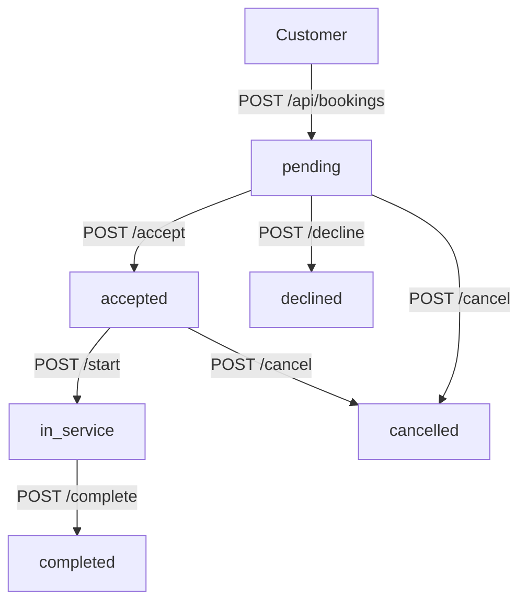

# Frontend Integration Skill

Generate a frontend integration guide for a completed ayos-moto-server backend module.
Output is a markdown file the frontend team can follow directly.

---

## 1. When to Activate

Trigger phrases:
- "backend done, implement on frontend"
- "create integration guide for [module]"
- "ready for frontend, document [feature]"
- "frontend integration for [feature]"

---

## 2. Research Order (Before Writing)

Execute ALL steps before writing the guide.

### Step 1 — Identify Module

Locate module under `src/modules/<module>/`. Known modules:
`auth`, `users`, `shops`, `bookings`, `notifications`, `vehicles`, `dashboard`

### Step 2 — Read Source Files (in order)

```
src/modules/<module>/routes/<module>.routes.js     ← endpoints, auth, swagger JSDoc
src/modules/<module>/validators/<module>.validators.js  ← exact request shape (Zod)
src/modules/<module>/services/<module>.service.js  ← business rules, error codes
src/modules/<module>/<module>.controller.js        ← response shapes
```

If module uses legacy services: also read `src/services/<module>.service.js`

### Step 3 — Check for Simulator

```
simulate/<module>/          ← look for related .html files
simulate/<any-folder>/      ← check all if unsure
```

If simulator found:
- Read the full HTML file
- Extract: API calls made, request bodies, response handling, UX flows, actions confirmed working

### Step 4 — Read Supporting Files

```
src/modules/<module>/<module>.dto.js        ← response shapes (if exists)
src/modules/<module>/<module>.types.js      ← enum/type definitions (if exists)
prisma/schema.prisma                        ← field names, types, relations
apis/<module>.http                          ← test file (if exists)
```

### Step 5 — Check Auth Middleware

```
src/middleware/authenticate.middleware.js
src/middleware/authorize.middleware.js
```

Understand token structure, role checking pattern.

---

## 3. Output File

**Path:** `docs/frontend/<module>-integration.md`

Create directory if missing. Always overwrite if regenerating.

**Title format:** `# [Module Name] — Frontend Integration Guide`

---

## 4. Document Structure

The generated markdown MUST follow this structure exactly:

```
# [Feature] — Frontend Integration Guide

## Overview
## Tech Stack Assumptions
## Authentication
## Endpoints
  ### [METHOD] [path]
## State Management
## UX Recommendations
## Error Handling
## Data Flow Diagram (optional, mermaid)
## Implementation Checklist
```

---

## 5. Section Content Rules

### Overview
- Feature purpose in 2–3 sentences
- Which user roles interact with this feature
- Link to simulator if found: `[Simulator](../../simulate/<path>/<file>.html)`

---

### Tech Stack Assumptions
Always include:
```
- React Native + Expo
- Axios (or fetch) for HTTP
- AsyncStorage for token persistence
- React Navigation for routing
- Zustand / Context API for state (recommend based on complexity)
```

---

### Authentication

Show token attach pattern:
```js
// axiosClient.js
axios.defaults.headers.common['Authorization'] = `Bearer ${accessToken}`;
```

List required roles per endpoint group.

---

### Endpoints

For each endpoint, generate a section:

```markdown
### POST /api/<module>/...

**Auth:** `Bearer <JWT>` — Role: `CUSTOMER` | `SHOP_OWNER` | `SUPER_ADMIN` | Any

**Request Body:**
\`\`\`json
{
  "field": "value"    // type, constraints
}
\`\`\`

**Required fields:** list them

**Optional fields:** list them with defaults

**Success Response `2xx`:**
\`\`\`json
{
  "success": true,
  "data": { ... }
}
\`\`\`

**Error Responses:**
| Status | Code | When |
|--------|------|------|
| 400 | VALIDATION_ERROR | ... |
| 401 | UNAUTHORIZED | Token missing/expired |
| 403 | FORBIDDEN | Wrong role |
| 404 | NOT_FOUND | ... |
| 409 | CONFLICT | ... |

**UX Notes:**
- [context-specific UX guidance based on API behavior]
```

Extract field types and constraints FROM Zod validators — do not guess.

---

### State Management

Based on complexity:

**Simple (1–2 endpoints, no pagination):** useState + useEffect
**Medium (list + CRUD):** useReducer or Zustand slice
**Complex (real-time, multi-role, notifications):** Zustand store + WebSocket/polling

Provide a minimal state shape:
```js
// Example shape
const bookingState = {
  bookings: [],
  loading: false,
  error: null,
  selectedBooking: null,
};
```

---

### UX Recommendations

Rules for generating UX recommendations:
1. Derive from actual API behavior — never invent features the API doesn't support
2. Consider the booking status machine if status transitions exist
3. For list endpoints: recommend pull-to-refresh + pagination if `page`/`limit` params exist
4. For actions with confirmation (accept/decline/cancel): recommend bottom sheet or modal confirm
5. For idempotency key patterns (booking create): recommend client-side UUID generation + SHA-256 hash
6. For role-scoped list endpoints: note what changes per role
7. For notification endpoints: recommend unread badge count in tab bar / nav header

UX recommendation format:
```markdown
#### [Screen or Component Name]
- **Pattern:** [Bottom Sheet / Modal / Inline form / Full screen / etc.]
- **Trigger:** [What user action opens this]
- **Fields / Inputs:** [list]
- **Success behavior:** [navigate / toast / refresh list / etc.]
- **Error behavior:** [inline error / toast / retry button]
- **Loading behavior:** [skeleton / spinner / button disabled]
```

---

### Error Handling

Standard error response shape from this API:
```json
{
  "success": false,
  "message": "Human readable message",
  "code": "MACHINE_READABLE_CODE"
}
```

Always provide:
```js
// Recommended axios interceptor
axios.interceptors.response.use(
  (res) => res,
  (err) => {
    const { status, data } = err.response ?? {};
    if (status === 401) { /* refresh token or logout */ }
    if (status === 403) { /* show role error */ }
    return Promise.reject(data ?? err);
  }
);
```

List module-specific error codes extracted from service files.

---

### Data Flow Diagram (Mermaid)

Include when feature has multi-step flow (status machine, multi-role, etc.):



---

### Implementation Checklist

```markdown
- [ ] Auth token attached to all requests
- [ ] Handle 401 → refresh or logout
- [ ] [feature-specific items]
- [ ] Loading state on all async actions
- [ ] Error displayed to user (not just console.log)
- [ ] Pull-to-refresh on list screens (if applicable)
- [ ] Optimistic update or refetch after mutations
```

---

## 6. Simulator Analysis Rules

When a simulator HTML file exists:

1. **Extract confirmed working flows** — functions that make real API calls (fetch/apiFetch)
2. **Note exact request bodies** used (these are ground truth)
3. **Note response fields accessed** — these confirm actual response shape
4. **Extract UX patterns implemented** — overlays, toasts, status chips, tab filters
5. **Note seeded test data** — pre-filled credentials or IDs (e.g., `customer4@gmail.com`)
6. **Check event log** if present — reveals intended test scenarios

In the guide, note simulator-confirmed behavior:
```markdown
> ✅ **Simulator confirmed:** This flow was tested in `simulate/booking/create-booking.html`.
```

---

## 7. No Simulator Fallback

If no simulator exists:
1. Derive behavior strictly from routes + validators + service error throws
2. Mark fields with confidence: `[from Zod]`, `[from Swagger]`, `[inferred from service]`
3. Add notice at top of doc:
```markdown
> ⚠️ **No simulator found.** Guide derived from source code only. Verify against running API.
```

---

## 8. Project-Specific Knowledge

### Base URL
```
http://localhost:3000  (development)
```

### Standard Response Envelope
```json
{
  "success": true,
  "message": "...",
  "data": { ... }
}
```
Some endpoints use `{ "success": true, "booking": {...} }` — check controller for exact shape.

### Auth Flow
- Login: `POST /api/auth/login` → `{ data: { accessToken, refreshToken, user } }`
- Attach: `Authorization: Bearer <accessToken>`
- Refresh: `POST /api/auth/refresh` → new `accessToken`
- Store: `accessToken` + `refreshToken` in AsyncStorage

### JWT Payload Shape
```json
{ "userId": 1, "email": "user@example.com", "role": "CUSTOMER", "iat": ..., "exp": ... }
```
Decode client-side with base64 (no signature verification needed for display):
```js
const payload = JSON.parse(atob(token.split('.')[1]));
```

### Seeded Test Accounts
| Role | Email | Password |
|------|-------|----------|
| CUSTOMER | customer4@gmail.com | Password123! |
| SUPER_ADMIN | admin@gmail.com | Password123! |

### Booking Status Machine
```
pending → accepted → in_service → completed
pending → declined
pending/accepted → cancelled
```

### Notification Types
`SHOP_OWNER_APPLICATION`, `SHOP_OWNER_APPROVED`, `SHOP_OWNER_REJECTED`,
`BOOKING_REQUEST`, `BOOKING_CONFIRMED`, `BOOKING_CANCELED`

### Known Modules → Roles
| Module | Primary Role(s) |
|--------|----------------|
| auth | Any |
| users | Any (self) |
| shops | CUSTOMER (apply), SUPER_ADMIN (verify), SHOP_OWNER (manage) |
| bookings | CUSTOMER (create/cancel/review), SHOP_OWNER (accept/decline/start/complete/assign) |
| notifications | Any (own notifications) |
| vehicles | CUSTOMER |
| dashboard | SUPER_ADMIN, SHOP_OWNER |

---

## 9. Output Quality Rules

- Exact field names from Zod / Prisma schema — never guess snake_case vs camelCase
- Exact HTTP status codes from Swagger JSDoc
- Error codes from service `throw new AppError(...)` calls
- UX derived from actual API constraints (don't suggest features the API doesn't support)
- No placeholder text — all sections complete
- Mermaid diagrams only for multi-step flows — skip for simple CRUD
- Simulator findings override inferred behavior

---

## 10. Workflow Summary

```
User: "Frontend integration for [module]"
    ↓
Read routes → validators → service → controller
    ↓
Check simulate/ for matching HTML
    ↓
Read prisma/schema.prisma for field types
    ↓
Read .dto.js / .types.js if exist
    ↓
Generate docs/frontend/<module>-integration.md
    ↓
Report: path written, key decisions, any ambiguities
```
